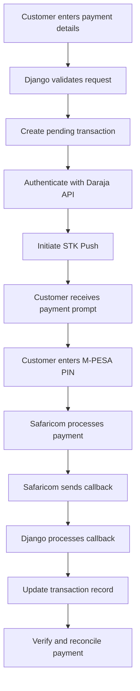

# Django M-PESA Gateway

A reusable, Django-powered M-PESA payment gateway built on the **Safaricom Daraja API**. Designed to help developers integrate mobile money payments into Django applications through a centralized, configurable and extensible payment system.

Developed by **Harry Porter Digital Services (HPDS)**.


---

## Overview

Django M-PESA Gateway provides a reusable foundation for integrating Safaricom M-PESA payments into Django-powered applications.

Instead of implementing Daraja API authentication, STK Push requests, callback handling and transaction management separately in every project, developers can use this gateway as a centralized payment integration layer.

The system is designed to support different business payment configurations, including PayBill and Buy Goods (Till).

## Features

### Payment Integration
- Safaricom Daraja API integration.
- M-PESA STK Push initiation.
- PayBill payment configuration.
- Buy Goods (Till) payment configuration.
- Sandbox and production environment configuration.
- Automatic OAuth access-token management.

### Transaction Management
- Unique internal transaction references.
- Customer phone number tracking.
- Transaction amount and payment method tracking.
- Merchant and Checkout Request ID storage.
- M-PESA receipt number recording.
- Transaction status management.
- Callback processing and duplicate callback protection.
- Payment verification and reconciliation foundation.

### Developer Features
- Reusable Django application architecture.
- Environment-based configuration.
- SQLite and PostgreSQL database support.
- Django administration interface.
- Web-based payment testing interface.
- Transaction monitoring dashboard.
- Extensible service layer for future integrations.

---

## Technology Stack

| Technology | Purpose |
|---|---|
| Python | Core programming language |
| Django | Backend framework |
| SQLite | Development database |
| PostgreSQL | Production database option |
| Bootstrap 5 | Responsive frontend |
| Safaricom Daraja API | M-PESA integration |
| Requests | HTTP communication |
| Python Dotenv | Environment configuration |

---

## Project Structure

```text
django-mpesa-gateway/
│
├── config/
│   ├── settings.py
│   ├── urls.py
│   ├── asgi.py
│   └── wsgi.py
│
├── mpesa/
│   ├── migrations/
│   ├── services/
│   │   ├── __init__.py
│   │   ├── daraja.py
│   │   └── payments.py
│   │
│   ├── templates/
│   │   └── mpesa/
│   │       ├── home.html
│   │       ├── test_payment.html
│   │       └── transactions.html
│   │
│   ├── admin.py
│   ├── apps.py
│   ├── forms.py
│   ├── models.py
│   ├── urls.py
│   └── views.py
│
├── .env
├── .gitignore
├── manage.py
├── requirements.txt
└── README.md
```

---

## Getting Started

### 1. Clone the repository

```bash
git clone https://github.com/YOUR-USERNAME/django-mpesa-gateway.git

cd django-mpesa-gateway
```

### 2. Create a virtual environment

Windows:

```powershell
python -m venv venv

.\venv\Scripts\Activate.ps1
```

Linux/macOS:

```bash
python3 -m venv venv

source venv/bin/activate
```

### 3. Install dependencies

```bash
pip install -r requirements.txt
```

### 4. Configure environment variables

Create a `.env` file in the project root.

Example:

```dotenv
SECRET_KEY=your-django-secret-key
DEBUG=True

ALLOWED_HOSTS=127.0.0.1,localhost

DB_ENGINE=sqlite
DB_NAME=mpesa_gateway

MPESA_ENVIRONMENT=sandbox
MPESA_CONSUMER_KEY=your-consumer-key
MPESA_CONSUMER_SECRET=your-consumer-secret

MPESA_SHORTCODE=174379
MPESA_PASSKEY=your-sandbox-passkey

MPESA_TILL_NUMBER=

MPESA_CALLBACK_URL=https://your-ngrok-domain/mpesa/callback/

MPESA_ACCOUNT_REFERENCE=HPDS
MPESA_TRANSACTION_DESC=Payment

TIME_ZONE=Africa/Nairobi
```

**Important:** The shortcode and passkey above are placeholders for sandbox configuration. Obtain the correct credentials and configuration from your Safaricom Daraja developer account.

Never commit your `.env` file or expose your production credentials.

### 5. Apply database migrations

```bash
python manage.py makemigrations
python manage.py migrate
```

### 6. Create an administrator

```bash
python manage.py createsuperuser
```

### 7. Start the development server

```bash
python manage.py runserver
```

Open:

- Gateway homepage: http://127.0.0.1:8000/
- Test STK Push: http://127.0.0.1:8000/mpesa/test/
- Transactions: http://127.0.0.1:8000/mpesa/transactions/
- Administration: http://127.0.0.1:8000/admin/

---

## Safaricom Daraja Configuration

To use the gateway, you need a Safaricom Daraja developer account.

1. Visit [Safaricom Daraja](https://developer.safaricom.co.ke/).
2. Register or sign in.
3. Create an application.
4. Select the M-PESA API products required.
5. Obtain your Consumer Key and Consumer Secret.
6. Configure your sandbox or production credentials.
7. Set up a publicly accessible HTTPS callback URL.

### Supported payment methods

| Payment method | Daraja transaction type |
|---|---|
| PayBill | `CustomerPayBillOnline` |
| Buy Goods (Till) | `CustomerBuyGoodsOnline` |

For PayBill transactions, the business shortcode identifies the PayBill, while the account reference identifies the customer's invoice or account.

For Buy Goods transactions, the configured Till number identifies the receiving merchant.

---

## Payment Workflow



---

## Callback Configuration

Safaricom requires a publicly accessible HTTPS endpoint to send STK Push transaction results.

The default callback endpoint is:

```text
https://your-domain.com/mpesa/callback/
```

For local development, you can expose your Django server using [ngrok](https://ngrok.com/).

Example:

```bash
ngrok http 8000
```

Use the generated HTTPS URL in your `.env` file.

Remember to update your callback URL whenever your temporary ngrok hostname changes.

---

## Database Configuration

The gateway supports:

**SQLite**

Recommended for local development and initial testing.

```dotenv
DB_ENGINE=sqlite
```

**PostgreSQL**

Recommended for production deployments.

```dotenv
DB_ENGINE=postgresql
DB_NAME=mpesa_gateway
DB_USER=your_database_user
DB_PASSWORD=your_database_password
DB_HOST=localhost
DB_PORT=5432
```

Install the appropriate PostgreSQL driver before using this configuration.

---

## Security Considerations

Payment integrations require careful handling of customer and transaction data.

This project incorporates a security-conscious foundation, including:

- Environment-based storage of sensitive configuration.
- CSRF protection for normal browser forms.
- CSRF-exempt Daraja callback endpoint.
- Transaction references for payment tracking.
- Duplicate callback processing protection.
- Separation of payment initiation and callback processing.
- Database-backed transaction records.

Before production deployment, implement and verify:

- HTTPS across the entire application.
- Authentication and authorization for transaction dashboards.
- Strict validation of payment callbacks.
- Independent payment status verification and reconciliation.
- Rate